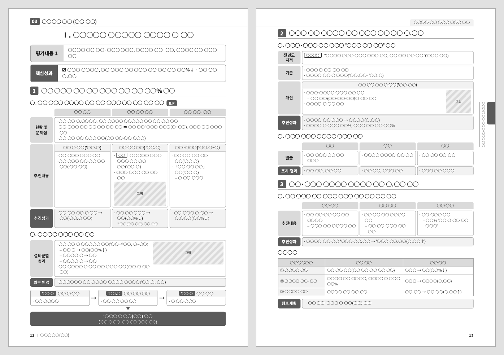

# 실적보고서 작성 스킬 (performance-report-writer)

## 변경 이력

### v2.1 (v2.0 대비)

- 양식 재현보다 자료 분석과 평가자 관점의 흐름·구조 설계를 중심으로 작성 원칙을 강화했습니다.
- 특정 기관·부서·주제에 종속되지 않도록 범용화하고, 자료·양식·성과지표의 첨부 조합에 따라 방향과 형식을 정하도록 정리했습니다.
- 양식이 없을 때 사용할 기본 양식을 추가했습니다.
- 원자료의 사진·그래프와 전년도 지적사항, 전년·목표·도입 전후 비교값 중 메시지에 필요한 것만 선별해 반영하도록 했습니다.

---

흩어진 실적 자료를 AI가 끝까지 읽고 분석해서, **평가자가 한눈에 이해하는 흐름**으로 엮은 실적보고서(PDF·Word)를 만들어 줍니다.

**[스킬 zip 받기](https://github.com/BrightAsh/performance-report-writer/releases/latest/download/performance-report-writer.zip)** · [PROMPT.md (다른 AI용)](PROMPT.md) · 라이선스 [CC BY-NC 4.0](LICENSE)

양식을 채우는 도구가 아닙니다. 방대한 자료에서 **무엇을 고르고, 어떤 순서와 구조로 말해야 메시지가 잘 보이는지** 설계하는 데 초점을 둡니다. 경영평가 실적보고서, 내부 성과보고서, 사업 결과보고서 등 어느 조직·부서·주제에도 씁니다.

- **양식이 없어도**: 공공기관 실적보고서에서 널리 쓰는 기본 양식(평가내용 → 핵심성과 → 대제목 → 왼쪽 라벨 칸 표)으로 씁니다.
- **자료 속 그림**: 원자료에 있는 사진·그래프·시스템 화면 중 문장을 뒷받침하는 것만 골라 관련 칸 안에 작게 넣습니다. 새로 그리지 않습니다.
- **비교 값**: 전년 대비·도입 전후·목표 대비 값과 전년도 지적사항을 찾아, 메시지를 뒷받침하는 것만 계산해서 넣습니다.


*기본 양식으로 만든 결과물 예시입니다. 글자는 ○로, 그림은 회색 상자로 가리고 구조만 보이게 했습니다([예시 전체 보기](examples/demo/)).*

---

## 무엇을 넣으면 무엇이 나오나

| 구분 | 첨부할 것 | 하는 일 |
|---|---|---|
| **필수** | **작성 자료**: 결과보고, 계획, 증빙, 회의자료, 과제 목록 엑셀 등 | 보고서 내용의 근거 |
| 선택 | **양식**: 따라 하고 싶은 보고서 샘플 | 구조·말투·지면을 그대로 따름 |
| 선택 | **성과지표**: 편람, 지표 정의서, 평가 기준 | 보고서의 방향과 목차를 지표에 맞춤 |
| 선택 | **가이드라인**: 작성요령 | 쪽수·글자 크기 등 규정을 지킴 |

지원 형식: PDF, HWP, HWPX, DOCX, XLSX, PPTX, 이미지

| 첨부 조합 | AI가 하는 일 |
|---|---|
| 자료만 | 자료를 분석해 방향과 구조를 스스로 정하고, 기본 양식으로 작성 |
| 자료 + 양식 | 양식의 구조·말투·지면대로 작성 |
| 자료 + 성과지표 | 지표의 평가 항목을 목차 뼈대로 삼아 기본 양식으로 작성 |
| 자료 + 양식 + 성과지표 | 지표로 '무엇을', 양식으로 '어떻게'를 정해 작성 |

**받는 것:** PDF·Word 파일, 스토리라인(구성) 요약, 자료 사용 내역(무엇을 왜 넣고 뺐는지, 넣은 그림·비교 값의 출처), 확인이 필요한 사항

---

## 빠른 시작

1. 아래 '설치'에서 쓰는 AI에 맞게 스킬이나 프롬프트를 넣습니다.
2. 작성 자료(필요하면 양식·성과지표도)를 첨부합니다.
3. 이렇게 요청합니다.
   - "첨부 자료로 경영평가 실적보고서 2쪽 써줘"
   - "이 양식대로, 첨부한 지표에 맞춰 3쪽으로 써줘"
   - "구성안(스토리라인)만 먼저 보여줘"
   - "○○ 사업을 대표 사례로 강조해줘"
   - "사용법 알려줘" → 스킬이 안내를 보여줍니다

---

## 설치

### Claude (claude.ai 웹·앱)
1. **[performance-report-writer.zip 받기](https://github.com/BrightAsh/performance-report-writer/releases/latest/download/performance-report-writer.zip)** — 압축을 풀지 말고 그대로 씁니다.
2. Claude 설정에서 **코드 실행**을 켜고, **스킬** 메뉴에서 zip을 업로드합니다.
3. 자료를 첨부하고 요청하면 스킬이 자동으로 켜집니다.

> **회사망에서 위 링크가 막히면**: [저장소 전체 zip](https://github.com/BrightAsh/performance-report-writer/archive/refs/heads/main.zip)을 받아 압축을 풀고, 안의 `dist/performance-report-writer.zip`을 업로드하세요. 저장소 전체 zip은 폴더 이름이 `performance-report-writer-main`이라 그대로 올리면 스킬로 인식되지 않습니다.
>
> 파일 하나만 올릴 수 있는 환경이면 [`dist/SKILL_single_file.md`](dist/SKILL_single_file.md)를 쓰세요. 참고 문서와 스크립트가 한 파일에 들어 있습니다.

### Claude Code
```bash
git clone https://github.com/BrightAsh/performance-report-writer ~/.claude/skills/performance-report-writer
```
프로젝트 전용으로 쓰려면 프로젝트의 `.claude/skills/` 아래에 받습니다.

### 그 밖의 스킬 지원 도구 (OpenAI Codex, Gemini CLI, Cursor, GitHub Copilot 등)
이 스킬은 공개 표준인 **Agent Skills(SKILL.md) 형식**을 따릅니다. 각 도구의 스킬 폴더에 이 폴더를 넣으면 됩니다. 폴더 위치는 도구마다 다르니 해당 도구의 문서를 확인하세요.

### 스킬을 지원하지 않는 AI (ChatGPT, Gemini 웹 등)
| 방법 | 쓰는 파일 |
|---|---|
| 대화창에 붙여넣기, 또는 원문 링크를 주고 "이 지침대로 해줘" | [`PROMPT.md`](PROMPT.md) ([원문 링크](https://raw.githubusercontent.com/BrightAsh/performance-report-writer/main/PROMPT.md)) |
| 맞춤형 GPT·Gem의 지침 칸 (8,000자 이내) | [`PROMPT.md`](PROMPT.md) (약 6,600자) |
| 짧은 지침 칸 (4,000자 이내, Claude 프로젝트 지침 등) | [`PROMPT_SHORT.md`](PROMPT_SHORT.md) (약 3천 자, [원문 링크](https://raw.githubusercontent.com/BrightAsh/performance-report-writer/main/PROMPT_SHORT.md)) |

코드를 실행할 수 없는 AI는 PDF·Word 대신 **Markdown 지면안**으로 결과를 줍니다. 한글·Word에 옮겨 쓰면 됩니다.

HWPX가 필요하면 Word 파일을 한글에서 열어 'HWPX로 저장'하세요.

---

## 어떻게 작동하나

```
첨부 판별 → 자료 분석 → 방향 설정 → 흐름·구조 설계 → 문체 → 지면 → 결과물 → 점검
 (역할)     (사실 카드)   (핵심 메시지)   (스토리라인)    (양식 말투) (블록)  (PDF·Word) (사실 대조)
```

| 단계 | 핵심 |
|---|---|
| 첨부 판별 | 첨부마다 자료 / 양식 / 성과지표 / 가이드라인 역할을 정함 |
| 자료 분석 | 끝까지 읽고 모든 사실을 출처와 함께 카드로 뽑음 → 성과·파급에 가중치 → 사업별 A/B/C 등급. 비교 값(전년·전후·목표)과 그림 후보도 따로 모음 |
| 방향 설정 | 지표가 있으면 평가 항목이 목차, 없으면 자료에서 도출 → 핵심 메시지 1문장 + 축 2~4개 |
| **흐름·구조 설계** | 결론부터, 주장형 제목, 제목만 읽어도 이해되는 흐름, 문제와 성과 숫자의 짝, 비교 기준 있는 숫자 |
| 문체·지면 | 양식이 있으면 말투·지면을 그대로, 없으면 기본 양식 |
| 블록 | 내용 성격에 맞는 블록(라벨 칸 표, 흐름, 로드맵, 비교, 성과 띠 등). 그림은 관련 칸 안에 작게, 쪽당 0~3개 |
| 결과물 | PDF + Word, 지정 쪽수 정확히 맞춤 |
| 점검 | 모든 수치를 원문과 대조, 계획과 완료 구분, 지어낸 내용 없음 |

자세한 방법은 [`references/`](references/)에 단계별로 있습니다.

---

## 폴더 구조

```
performance-report-writer/
├── SKILL.md            스킬 진입점 (AI가 읽음)
├── PROMPT.md           스킬 미지원 AI용 전체 지침 (8,000자 이내)
├── PROMPT_SHORT.md     짧은 지침 (4,000자 이내)
├── references/         단계별 방법 8개 + 기본 양식 명세(09)
├── scripts/            첨부 텍스트·그림 추출, PDF 영역 자르기, 비교 값 계산, PDF·Word 렌더러, 지면 점검
├── assets/             content.json 빈 틀, 작업 기록 서식
├── examples/demo/      가상 기관 예시 (원자료 → 사실 카드 → 스토리라인 → 마스킹한 결과 지면)
├── dist/               설치용 zip, 단일 파일판 SKILL (참고 문서·스크립트를 한 파일에 합침)
├── tools/              설치용 zip·단일 파일판 생성, 공개용 마스킹 도구
└── LICENSE             CC BY-NC 4.0
```

---

## 직접 실행 (개발자용)

```bash
npm install                       # Word 렌더러(docx)
pip install -r requirements.txt   # 필요한 것만
python -m playwright install chromium

# 첨부 일괄 추출 (텍스트 + 그림 + 미리보기 모음)
python3 -I scripts/read_inputs.py work/inputs 자료1.pdf 자료2.hwpx 지표.pdf

# PDF 속 그래프 자르기 / 비교 값 계산
python3 scripts/crop_pdf.py 자료1.pdf 5 --grid work/inputs
python3 scripts/compare.py 140 462 명 --years 24 25

# 데모 다시 만들기 / 공개용 마스킹본 만들기
npm run demo
python3 tools/mask_content.py examples/demo/content.json examples/demo/content_masked.json

# 단일 파일판·설치용 zip 다시 만들기 (SKILL.md·references·scripts를 고친 뒤)
python3 tools/build_single_file.py
python3 tools/build_zip.py
```

---

## 주의

- AI가 만든 보고서는 **반드시 사람이 확인한 뒤** 제출하세요. 스킬은 수치를 원문과 대조하고, 확인이 필요한 항목을 따로 알려 줍니다.
- 내부 자료를 외부 AI 서비스에 올릴 때는 소속 조직의 보안 규정을 따르세요.
- 예시(`examples/`)의 기관명·수치·그림은 모두 가상입니다. 자신의 결과물을 공개할 때는 `tools/mask_content.py`로 내용과 그림을 가린 지면을 쓰세요.
- 이 저장소에는 실제 기관의 보고서·양식 파일을 넣지 않습니다. 기본 양식은 지면 구조만 글과 코드로 옮긴 것입니다.

---

## 라이선스

[CC BY-NC 4.0](LICENSE) (저작자표시-비영리). 비영리 목적이라면 자유롭게 쓰고 고칠 수 있습니다. 공유할 때는 저작자(KNOC)와 라이선스를 표시하고, 고쳤다면 고쳤다고 밝혀 주세요. 상업적으로 쓰려면 먼저 [이슈](https://github.com/BrightAsh/performance-report-writer/issues)로 연락 주세요.

제작: KNOC
